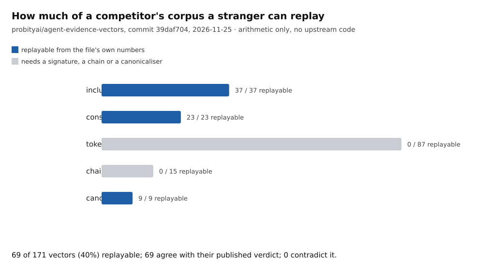

# 一次扫完 171 条：竞品语料有多少能被外人复算（上游 HEAD `39daf704`）

对象：`probityai/agent-evidence-vectors` 的 `vectors-poc-evidence/package/poc_evidence_vectors/corpus`，2026-11-25 抓到 HEAD `39daf704`（2026-11-25T04:11:38Z），**171 个 JSON**（inclusion 37、consistency 23、token 87、chain 15、canonical 9）。

之前我们只看过三条 `size=0`（`docs/upstream-package/competitor-defects/README.md`）。三条是抽样，抽样只证明抽样。这次把每条向量都按它自己写的数字重算一遍，只看两个问题：

1. 不拿对方代码，这条文件能不能被复算？
2. 能复算的那些，文件自己的数字和它自己发布的 verdict 对得上吗？

判据全部是公开标准，没有一条来自对方代码：

- **inclusion**：叶 = `SHA-256(0x00 ‖ record)`；按 `index`、`tree_size` 折叠 `proof`，比对 `root`；`proof` 条数先按 `(index ^ (size-1))` 的分解定出应有多少条；`index` 越界、`tree_size = 0` 却带非空树根，都是数字自己给出的结论。
- **consistency**：用 `old_root` 和 `proof` 推出第二棵树应有的根，比对 `new_root`；`old_size = 0` 但 `old_root` 不是空树常量、`new_size < old_size`、证明链不通，同样是数字自己给出的结论。
- **canonical**：把 `text` 用 **RFC 8785（JCS）** 规范化——一个公开标准，`tools/jcs.py` 自己实现，不借任何库——再比对 `canonical_sha256` 与 `canonical_len`。
- **token / chain**：判定最终靠 schema 与签名语义，签名的"可验性"单独量出来（见下），但不把签名通过当成 verdict。



（图由 `tools/build_corpus_sweep_svg.py` 从收据生成，`--check` 在 CI 里跑；数字改不了图，图也不会自己漂。）

## 结果（`corpus-sweep-39daf704.json` 是收据）

| 类别 | 向量 | 可复算 | 发布 accept | 发布 reject | 与数字一致 | 与数字矛盾 |
|---|---|---|---|---|---|---|
| inclusion | 37 | 37 | 22 | 15 | 37 | 0 |
| consistency | 23 | 23 | 10 | 13 | 23 | 0 |
| canonical | 9 | 9 | 9 | 0 | 9 | 0 |
| token | 87 | 0 | 17 | 70 | — | — |
| chain | 15 | 0 | 5 | 10 | — | — |
| **合计** | **171** | **69（40%）** | 63 | 108 | **69** | **0** |

四句话读完：

1. **40% 能复算**（69/171），而且 **69 条全部自洽**：0 条出现"发布 accept，却给出自己的数字造不出的根"，也 0 条给出 JCS 造不出的规范化摘要。
2. **canonical 那 9 条是对得上公开标准的**：`JCS(text)` 逐条复现 `canonical_sha256` 与字节长度，9/9。这条是我们的新发现，也是把可复算比例从 35% 抬到 40% 的那 9 条。
3. **token 的签名能验，但 verdict 不能**：87 条里 **74 条的 Ed25519 签名在 `JCS(body 去掉 signature)` 上验得过**（17/17 的 accept 全部通过；13 条 reject 签不过，正合其 reject 预期）。签名约定可以从文件本身推出来，可 verdict 还要看 schema，所以 token 仍然计为不可复算——签名通过不是 verdict。
4. 所以"上游 0/3"那三条的毛病，量级就是三条，不是一类系统性错误。写成"他们有 171 条问题"是不诚实的，这份扫描正好挡住那种写法。

## 这份扫描不能证明什么

- **不等于跑过他们的验证器**。这里只重算文件里的数字与标准化摘要，没有执行他们的代码，也没有对他们的实现下任何结论。
- **0 矛盾不等于实现正确**。文件自洽只说明"测试数据没写错"，不说明"被测实现算对了"。
- **签名通过不等于 accept**。74/87 签名验得过，只是说签名层没问题；一条能被拒掉的向量照样可以带一个合法签名。
- **chain 那 15 条连签名都没试**：它们的记录是嵌套的，签名覆盖哪一段由 schema 决定，这次没有猜。
- **一次快照**。171 个文件的 sha256 全在收据里，任何人可以按 `39daf704` 重抓、逐个对哈希、再跑一遍拿到同样的 69/0/102。

## 怎么自己跑

```bash
git clone https://github.com/probityai/agent-evidence-vectors && cd agent-evidence-vectors
git checkout 39daf704
python <this repo>/tools/sweep_competitor_corpus.py \
  --dir vectors-poc-evidence/package/poc_evidence_vectors/corpus --json
# TOTAL 171 vectors, replayable without their code 69 (40%), consistent 69, inconsistent 0, not replayable 102
```

`python tools/sweep_competitor_corpus.py --selftest` 是一组断言：常量、折叠、证明条数规则、下标规则、倒序尺寸规则、JCS 的键序与转义，以及最容易自我美化的那条——分类函数（accept+match 才算一致、reject+mismatch 才算一致）。

## 与我们自己的语料摆在一起

我们 63 条 RFC 9162 语料（inclusion 50 + consistency 13）没有一条要求读者信任我们的代码：每条都带正孪生、拒绝词表，并被 pymerkle、Sigstore `merkle.py`、Go `transparency-dev/merkle` 三份实现各自独立判过（`docs/THIRD-PARTY-CROSSCHECK.md`）。对方 171 条里 69 条能这样被判，102 条不能。

这是本轮唯一可比的"体量"：**可被外人独立复算的向量条数**，不是总条数。总数（3,069 套件条目 vs 63）我们不比，因为追不上也不影响可核验性。
