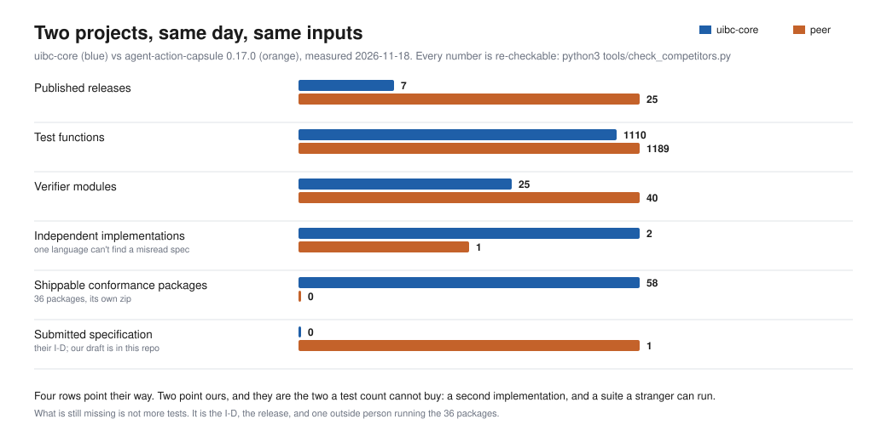

# Two projects in the same neighbourhood, measured on the same day

**Date of measurement: 2026-11-18.** Every number below can be re-run with the
command beside it. Nothing here is a claim about quality — the table lists what
each project ships, and the section after it says plainly where this project is
behind.

The other project is **`agent-action-capsule`** (AAC), the reference verifier for
`draft-mih-scitt-agent-action-capsule`, from Action State Group. It is the closest
thing to a peer this project has: same subject (a sealed record of what an agent
did, and a way for a third party to check it), same instinct (a format plus a
verifier that refuses malformed input).

## The two projects, side by side

| | `uibc-core` | `agent-action-capsule` |
|---|---|---|
| Version measured | 0.4.0-dev on `main` (`1f7c957`); 0.3.3 on PyPI | 0.17.0 on PyPI |
| First published | 4 releases, latest 2026-11-15 | 23 releases, latest 2026-11-18 |
| Specification | In this repo: `drafts/draft-zhao-uibc-evidence-chain-00.md`, **not submitted** | IETF Internet-Draft `draft-mih-scitt-agent-action-capsule`, referenced from the package itself |
| Licence | Apache-2.0 | BSD-3-Clause |
| Language of the verifier | Python (first) **and JavaScript (second, independent)** | Python, TypeScript, Go and Rust, all driven by the same vector corpus |
| Verifier modules | 27 | 40 |
| Test files / test functions | 131 / 816 | 95 / 1189 |
| Conformance material | 30 packages (20 must-reject, 1 control, 9 must-accept), shipped with per-case `expected.json`, two of them carrying the outside input S9 and S19 need, rebuildable byte for byte, and every must-reject case naming its basis in `docs/GROUNDS.md` | 1,952 cases in 55 sets under `vectors/`, referenced by tests, in neither the sdist nor the wheel |
| Second implementation is a **CI gate** | Yes — `second-implementation` job, 18 of 20 checks, 36/36 identical FAIL sets | No second implementation to gate |
| Hostile-input suite | `tools/redteam_robustness.py`, 10 cases, table in `docs/ROBUSTNESS.md` | `tests/test_json_nesting_vectors.py`, `tests/test_verify_bounds.py`, `tests/test_parse.py` |
| Deep-nesting ceiling | **512 levels, both implementations, refuses with S11** | 128 levels, refuses at parse time |
| External time proof | RFC 3161 timestamp verified in both implementations (real FreeTSA token, 7/7 red-team on the token verifier) | SCITT transparency log via an anchor client and witness records |
| Stars / forks | 11 / 2 | 2 / 6 |
| Last push | 2026-11-18T15:11Z | 2026-11-18T14:57Z |

Re-run the machine-checkable half:

```
python3 tools/check_doc_facts.py            # ours: 816 tests, 27 modules, 20 checks
python3 tools/redteam_robustness.py         # ours: 10 of 10 refused
python3 tools/cross_impl_check.py --json    # ours: 36 of 36 identical
```

For AAC, install and run its CLI on the same hostile inputs:

```
pip install agent-action-capsule==0.17.0
agent-action-capsule verify notjson.json    # exit 2, "cannot read capsule"
agent-action-capsule verify nan.json        # exit 1, ok: False
agent-action-capsule verify deep.json       # exit 2, "nested more than 128 levels deep"
agent-action-capsule verify badutf.json     # exit 2, "utf-8 codec can't decode"
```

Measured 2026-11-18: all four refused, none crashed. Their depth ceiling is
explicit and their message names the limit — **that is better than what this
project did until today**, which recursed until the stack ended and reported S0
("the verifier broke") for an input the verifier had simply never been built to
survive. The lesson was taken: `MAX_NESTING = 512`, counted outside string
literals, refused as S11 on both sides, and the same treatment for a manifest
that parses as an array (it used to reach `.get()` and raise).

## This comparison re-checks itself

A table written once is a claim that decays. The numbers a public endpoint
answers are recorded in `docs/COMPETITORS.json` and re-fetched by:

```
python3 tools/check_competitors.py           # measures, diffs, exits non-zero on drift
python3 tools/check_competitors.py --json    # the same, machine-readable
python3 tools/build_competitors_svg.py > docs/COMPETITORS.svg
```

Two endpoints are read: PyPI's JSON (version, release count, last upload) and
GitHub's repository record (stars, forks, licence, last push). `GITHUB_TOKEN`
is optional; without it GitHub answers 403 from this host and the field is
reported as unmeasured rather than estimated.

Four rows cannot come from an endpoint - test functions, modules, number of
implementations, whether a specification was submitted. Those are the ones
measured by hand on the date at the top of this page, and the picture says so.



## Where this project is behind, stated plainly

1. **Specification standing.** AAC's format has an Internet-Draft at -05
   (2026-09-26). `uibc-core`'s has a draft in this repo and no submission. This
   is the single largest difference in external credibility, and no amount of
   local testing closes it.
2. **Adoption and transparency.** They have a merged contribution in the SCITT
   working group's repository, a third-party product shipping their verifier, an
   independent draft building on theirs, and a public log with 15134 entries. We
   have none of these; see the table above.
3. **Release cadence.** 23 releases against 4. AAC ships weekly; this project
   tags when a chapter of work closes.
4. **Surface area.** 40 modules against 25. AAC covers COSE/CBOR carriers,
   bilateral flows, ERC-8183 and x402 adapters, an anchor client, witness
   records. This project covers one format and one verifier, and says so.
5. **Test count.** 1189 against 527.

## Adoption, measured the peer's own way

Their `IMPLEMENTATIONS.md` groups evidence by strength, following RFC 7942, and
states the rule that makes it worth reading: an entry owned by an author of the
specification is not independent, however it is worded. I checked each merged
claim against GitHub on 2026-11-18 rather than taking the page's word for it:

| evidence | where | verified |
|---|---|---|
| test vectors merged into the IETF SCITT working group's shared repository | [ietf-wg-scitt/examples#3](https://github.com/ietf-wg-scitt/examples/pull/3) | merged 2026-06-26 |
| a third party's product shipped their verifier | [projnanda/nandatown#197](https://github.com/projnanda/nandatown/pull/197) | merged 2026-07-15, by a NANDA maintainer, not them |
| the same product added CCF write-receipt anchoring | [projnanda/nandatown#200](https://github.com/projnanda/nandatown/pull/200) | merged 2026-07-15 |
| an independent Internet-Draft builds on their extension points | draft-rampalli-scitt-capsule-provenance-binding-00 | active, sole author not a contributor |
| a live public CT-style log for capsule checkpoints | anchor.agentactioncapsule.org | 15134 entries, checkpoint 2026-10-31 |
| Microsoft maintainer pins their vectors in an open PR | microsoft/scitt-ccf-ledger#424 | open, not merged (they say so) |

**Ours: zero rows in the same table.** No merged upstream contribution, no third
party shipping this verifier, no independent draft citing it, no public log,
because nothing has been sent out yet. `docs/IMPLEMENTATION-STATUS.md` records
that honestly in their format rather than leaving it implied.

This is the difference the local tests cannot touch. Two implementations
agreeing with each other is a fact about this repository; a third party shipping
the verifier is a fact about the world, and only the second one is what a degree
committee, a standards reader or a customer treats as evidence.

## Where this project is ahead, also stated plainly

1. **Every must-reject case names what it rests on, and the page is generated.**
   All twenty must-reject cases carry a basis; five quote a sentence that
   `tools/check_grounds.py` re-finds in the vendored draft. `docs/GROUNDS.md`
   renders that table from the data and `tests/test_grounds_page.py` fails if the
   page and the data disagree, so a reader can open one page and argue with a
   verdict on its own terms.

   The correction this item needed: an earlier version of this section said AAC
   "says which specification owns them; no case says which sentence". Measured on
   their 0.17.0 checkout, that understated them. 28 of 828 vector JSON files carry
   a `section`/`sections` label, across 10 of 55 sets, and the labels are real
   document sections (`x402-v0.md §6.2`, `composed/v1: Members and Outcomes`).
   What none of them do is quote a sentence of the document. So the difference is
   not "they name nothing, we name a sentence": it is **sections on 10 of 55 sets
   against a quoted sentence on 5 of 20 cases, with the quotation re-found by a
   tool**. Narrower than what this section claimed yesterday, and still the only
   column where the counts are ours to lose.
2. **The corpus is rebuildable byte for byte.** `SOURCE_DATE_EPOCH=1794700800
   python tools/oracle_check.py --emit <dir>` reproduces `conformance/oracle`
   exactly, checked by `tests/test_oracle_reproducible.py` with a control at
   another epoch. AAC's byte-reproduction tests are tied to a Unix checkout
   (measured above: 17 of their sets fail on Windows for that reason alone).
   This is a claim about 30 cases being checkable, not about 30 being much.
3. **A hostile-input table where each row is a verdict.** Ten cases, both
   implementations, three properties (no crash, a verdict, a refusal), and the
   document explains why the two verdict lists may differ without being
   inconsistent.
4. **Anchoring checked in both languages, on a real token.** The RFC 3161
   verifier is written in Node with no dependencies, cross-checked against
   Python's `cryptography`, and red-teamed against seven token mutations.

Explicitly **not** ahead, now that the numbers are in: corpus size (1,952 against
30), number of implementations (AAC runs the same corpus in Python, TypeScript,
Go and Rust; this project has Python and JavaScript), test count (4,486 executed
there against 816 here), and specification standing.


## What "ahead" does not mean here

It does not mean "全面超越". On specification standing and release cadence this
project is clearly behind, and those two are the ones a reviewer will look at
first. What it means is narrower and checkable: **a claim that two independent
readers agree on the same packages cannot be produced by a one-language project,
and this project can produce it.**

The honest next step is not more local tests. It is:
- submit the draft, so the format has a standing that is not self-declared;
- publish 0.4.0, so the numbers above are reachable by a stranger;
- hand the 36-package suite to one outside person, so "two implementations
  agree" stops being a claim made only by the two implementations.

## Five comparators on the same ruler (2026-11-20)

Measured again a day later, with one more party included. The reason for this
section: an earlier draft of the table below left out `agent-action-capsule`,
which would have produced the sentence "only two projects publish a runnable
corpus". That sentence would have been **wrong**, and wrong in the direction
that flatters this project. It is recorded here rather than quietly fixed.

Four columns, each measuring *what is published*, not capability:

| | cases with expected verdicts | runs offline | second implementation | verdict traceable to a clause |
|---|---|---|---|---|
| Tyche / EATF | **13** (5 valid, 8 invalid; README states `5 verified, 8 rejected`) | yes (Python, 3 deps) | TypeScript (not exercised here) | no |
| Action State Group / AAC | **1,952** cases in **55** sets under `vectors/` (its own `scripts/check_vector_index.py` reports "55 vector sets with matching counts"); *not in the sdist or the wheel* | yes (Python; TS/Go/Rust sets listed, not run here) | yes (TypeScript, plus Go and Rust) | no |
| SCC-1 (Watts) | 0 public; **15** prose obligations; the document says a user-supplied record holds 88 frozen vectors | no verifier found | claims Python/TS agreement | partly |
| Asqav (Marques) | 0; **8** Cedar templates + **4** worked requests | no (Cedar engine not vendored) | no | partly |
| AAS-1 | **1** worked example; **12** audit assertions | no | no | partly (ISA/ISAE mapping) |
| this project | **30** (20 must-reject, 1 control, 9 must-accept), shipped with per-case `expected.json` | yes (zero dependencies) | yes (V1–V9) | yes: 20 rejects carry a basis, 5 a verbatim clause |

What the table now supports, and nothing more: **three of the five publish an
offline-runnable corpus with per-case expected verdicts** (this project 28,
AAC 1,952, EATF 13); two publish prose obligations or a plan. On corpus size this
project is **third of three**, by a factor of about seventy — see the correction
below, which replaces an earlier sentence that said "second of three".

### Correction (2026-11-20, later the same day)

This section first said AAC ships **36** cases and that this project was
therefore second on corpus size. Cloning the repository and running its own
index checker falsifies both halves: `scripts/check_vector_index.py` prints
`VECTORS.md lists 55 vector sets with matching counts`, and the per-set counts in
that table sum to **1,952**. `vectors/` holds 981 files. The 36 could not be
reproduced from the current repository at all — it is not a subset that any file
names, and the wheel and sdist carry no vectors. 36 was a number this project
wrote down and did not check; it is replaced, not footnoted.

So the honest comparison on this ruler is 1,952 against 28, and "we are second"
was a sentence that made the gap look like a margin. What is actually true:

- AAC's corpus is **larger by two orders of magnitude**, and split across 55
  sets with their own owning specs, so a reader can see which requirement each
  case belongs to. This project's 30 cases are one flat list.
- AAC implements the same corpus in **four languages** (Python, TypeScript, Go,
  Rust); this project has Python and a JavaScript second implementation.
- Measured here on Windows, AAC's Python suite gave **4,486 passed, 18 failed,
  14 skipped**. Every one of the 18 is an environment artefact, not a verdict:
  17 are "generator reproduces every file byte for byte" tests that compare
  regenerated bytes against committed ones (platform line endings and path
  separators), and one needs a POSIX shell (`WinError 2`). With a disclosed
  `write_text(newline="\n")` shim the set-level runner moved from 15 pass / 34
  fail to **31 pass / 17 fail** of 55 sets, the remainder still being byte
  reproduction. In other words: their corpus runs, and its reproducibility
  checks are tied to a Unix checkout.
- Their own gap is the one this project can actually close rather than merely
  claim: **no case names the clause it rests on**. 55 sets say which
  specification owns them; no case says which sentence of it. This project's
  reject cases each carry a basis, and `tools/check_grounds.py` re-finds the
  five verbatim quotes in the vendored drafts.

The one thing this project now has that neither of the other two runnable
corpora has: the corpus is **rebuildable byte for byte** from the tool
(`SOURCE_DATE_EPOCH=1794700800 python tools/oracle_check.py --emit <dir>`,
checked by `tests/test_oracle_reproducible.py`). That is a claim about 30 cases,
not about being ahead.


The distinguishing column is the last one: of the three runnable corpora, this
project is the only one measured here where every must-reject case names the
clause or the project decision it rests on, and where a checker verifies the
quotes verbatim (`tools/check_grounds.py`, 18 rejects, 5 with a clause). AAC's
vectors are named by mutation, which is traceable to a *behaviour*, not to a
document.

Still not claimable: stricter (SCC-1 has obligations with no counterpart here);
complete (this project has no audit-framework mapping, no identity standard
binding, no cross-sink semantics); or adopted (real-TSA anchoring and outside
reproduction remain zero).
